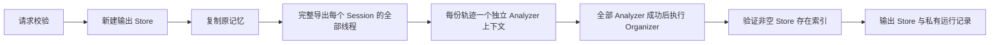

# Dreaming：公开合同与可执行核心

状态：实验性独立 runner；**不是已完成的 `/v1/dreams` 服务**。
研究基线：2026-11-09；代码基线：OMA `37f58f35837db48a6ca6c4058750e7646a282f1e`。

## 研究边界

只以 Anthropic 官方 API、研究和官方 Cookbook 作为机制依据，不移植其他 Memory 系统。此次二手检索主要找到 Cookbook 的转述、镜像与解读；没有找到足以证明托管 Dreams 私有 prompt、调度策略或内部模型调用图的独立证据，因而没有把这些推测写成实现事实。

| 来源 | 可确认内容 | 不能据此声称 |
| --- | --- | --- |
| [Create a Dream](https://platform.claude.com/docs/en/api/http/beta/dreams/create) | 一个 store、1–100 个不重复 session；排序后的响应 IDs；standard speed；instructions 1–4096 字符；create_new/update_existing | 私有整理算法 |
| [Dreams guide](https://platform.claude.com/docs/en/managed-agents/dreams) | 异步状态、保留部分输出、pipeline session 可观察性 | cookbook 等于托管实现 |
| [Cancel](https://platform.claude.com/docs/en/api/http/beta/dreams/cancel) / [Archive](https://platform.claude.com/docs/en/api/http/beta/dreams/archive) | canceled 幂等；completed/failed 不能取消；仅终态可归档，状态不变 | canceled 返回时 worker 已彻底停写 |
| [官方 Cookbook](https://platform.claude.com/cookbook/managed-agents-cma-dreaming-with-a-dynamic-workflow) | 每份 transcript 的 analyzer，全部结束后的 organizer；有限文件工具；wiki 和索引；不可信输入隔离 | 托管 API 必然使用这些角色、模型或 prompt |
| [Components of agent memory](https://www.anthropic.com/research/components-of-agent-memory) | 用原始轨迹校正笔记；形成可检索的表示；不要用僵硬保存规则替代模型判断 | 任意记忆提炼都能改善后续任务 |

官方 guide 的部分段落仍只描述默认的复制输出；`update_existing` 的请求结构和并发排他语义以当前 API Reference 为准。没有以 guide 的旧段落否定新版 Reference。

## 已实现范围

`internal/dreams` 提供请求校验、资源状态转换、双阶段工具驱动执行器和受限工具。`internal/dreamclient` 通过 OMA 现有 Memory Stores、Sessions、Threads、Events、Messages HTTP API 执行真实读写和模型调用。`cmd/dream` 提供可执行入口，不需要另外引入依赖。



这不是“一次把所有历史塞进 summarization prompt”。Analyzer 通过 read 工具读取原始输入；每个 Analyzer 有独立上下文，只有共享的输出记忆延续。Organizer 可以回查本次加载的原始轨迹。工具执行器记录每份轨迹实际读取的 Unicode 字符区间，遗漏任何区间都不能把 Analyzer 标为完成。

### 与官方示例的明确差异

- 当前使用确定性的串行调度，不使用 lead agent 动态生成 workflow，也不并行写同一 store。串行是本实现的并发安全取舍，不是关于 Anthropic 私有架构的结论。
- 调用 OMA `/v1/messages` 驱动工具循环，而非 Brain/Sandbox 的 Managed Session。因此当前 `session_id` 为 `null`；本地 `events.jsonl` 不是官方 Session event stream，不能冒充。
- 提示词是依据官方公开原则独立撰写，并非提取、恢复或复制出的托管 Dreams 私有提示词。
- 没有自动注入未来 session 的“高优先级记忆层”。文章讨论该能力，但当前 OMA harness 尚未接入，不能只写一个 Markdown 文件便声称已实现。
- 当前执行器只允许 `create_new`。请求校验认识 `update_existing`，但执行时在产生任何副作用前明确拒绝。

## 安全与失败语义

模型只获得 read/write/edit/glob/grep 五个逻辑工具。它们访问的是指定 source 集合与输出 Store 的 API，不是主机文件系统；不存在 shell、web、任意 URL 或任意输入 store 写入工具。原始轨迹和旧记忆不插入 system prompt；作为 tool result 提供并标为不可信数据。提示词要求不复制秘密，但这不是可证明的语义注入防护或 DLP。产出仍需审查，未来使用时优先只读挂载。

覆盖已有文档前必须完整读过对应版本，写入使用 OMA 的 `content_sha256` 前置条件；Edit 必须唯一匹配。写新路径遇到已有文件不自动改成覆盖。服务端前置条件才是并发校验边界，不能用客户端预读替代。

**Session 导出必须枚举 threads。** OMA `internal/sessions/service.go:listEvents` 在没有 thread ID 时使用 `PrimaryOnly=true`。只读取 `/sessions/{id}/events` 会漏掉子 Agent 的证据。当前导出逐线程、逐页读取，并保留 event ID、事件类型、工具错误和附件引用；不获取附件内容，文件头明确声明此限制。运行中或导出期间发生变化的 Session 会被拒绝。

- 创建的输出 ID 在复制/模型写入前记录，失败和 SIGINT/SIGTERM 取消不删除部分输出。
- 取消在下一安全检查点阻止后续工具，不能把已完成的网络写入回滚；没有声称具备分布式取消栅栏。
- 对截断回复、未读全轨迹、重复分页游标、丢失正文、hash 不一致和上下文超限均显式失败，不把残缺内容当成完成。
- 消息写请求不自动重试，避免不确定结果造成重复计费或重复写入。
- 限制总时长、每阶段 turns、每回复 tool 数量、模型请求字节数、总输入轨迹字节数、文档数量与大小。
- token 限额在回复之间检查，包含实际输入、输出和缓存 token；不是精确美元上限，一次已发出的请求可能令总量超过阈值。
- HTTP 默认要求 TLS；本地明文必须显式授权；禁止重定向携带 API key；所有 API 请求绑定同一 key 和可选 workspace header。
- 日志只保存操作元数据、路径、大小、hash 与 usage，不保存 transcript 或模型回复正文。result 中仍含用户 instructions，应按私密数据保存。目录 0700，文件 0600。

## 使用

在 OMA 已启动、workspace 已配置模型的环境中，从仓库根目录执行。仅校验不产生远端副作用，也不需要 API key：

```sh
go run ./cmd/dream -request docs/examples/dream-request.json
```

先替换示例中的真实 store/session/model IDs，再授权执行：

```sh
export OMA_API_KEY='your-workspace-key'
go run ./cmd/dream \
  -request /private/path/dream-request.json \
  -base-url http://localhost:38080 \
  -allow-insecure-http \
  -records-dir /private/path/new-dream-run \
  -execute
```

HTTPS 部署不要加 `-allow-insecure-http`。`-records-dir` 必须是不存在的新目录；未指定则创建私有临时目录。`result.json` 保存状态、输出 Store ID、usage 与错误；`events.jsonl` 保存执行事件。检查完成的输出，再把它只读挂到后续 Agent。不要把任何真实运行记录、API key 或业务 transcript 提交进仓库。

这些本地记录是检查点和审计，不是可恢复的任务队列。进程被硬杀、机器故障或不确定网络结果之后不能安全地自动续跑；可能需要依据记录检查和清理输出 Store。

## 测试与证据边界

```sh
go test -race -count=1 ./internal/dreams ./internal/dreamclient ./cmd/dream
go vet ./internal/dreams ./internal/dreamclient ./cmd/dream
```

测试覆盖请求边界、Unicode、状态机、输入/输出隔离、CAS、工具权限、完整读取、各预算、取消、部分产出、全线程与分页导出、重定向及错误文本泄露；还用本地 HTTP OMA fixture 与 scripted model 跑完整 Engine → HTTP → Memory 流程。

这些测试证明编排与协议适配，不证明真实模型的事实纠错能力、任务收益、生产 OMA 联调或官方 Dreams 等价性。本次开发环境不能解析 github.com，验证使用只含新增 stdlib 包的隔离工作目录及 Go 1.23.2；没有修改仓库 Go 版本。原仓库 Go 1.27 的全量构建、Yourbatis 生成、质量 hook 和真实基础设施验证不在本次已验证范围。新增独立 CI 在仓库原 Go 版本下验证这三个包；其结果以实际运行记录为准。

## 完整 API 仍需完成的集成

1. 基于 Yourbatis/PostgreSQL 的 Dream 持久化、租户范围和事务内入队；API handler 注册到原有 chi 鉴权路由，提供创建、读取、列表、取消和归档。
2. 复用 OMA durable worker、服务端模型凭证和计量，并用真实 Managed Session 承载可观察的 pipeline；不把这个 CLI 的本地 ID 冒充已持久化的资源。
3. `update_existing` 的数据库排他锁、租约所有权栅栏、取消后的停写确认、原子 CAS 与恢复策略；旧 worker 完全停止之前不得允许新 dream 获取同一 Store。
4. 原始输入快照/中途资源失效检查、可恢复 checkpoint、取消与提交的竞争测试，以及真实 PostgreSQL/对象存储/Brain 集成验证。
5. 官方 SDK 端到端合同测试与真实模型评测；比较原始 memory、普通摘要和本实现对后续任务的影响。没有这些证据不宣称质量对齐。
