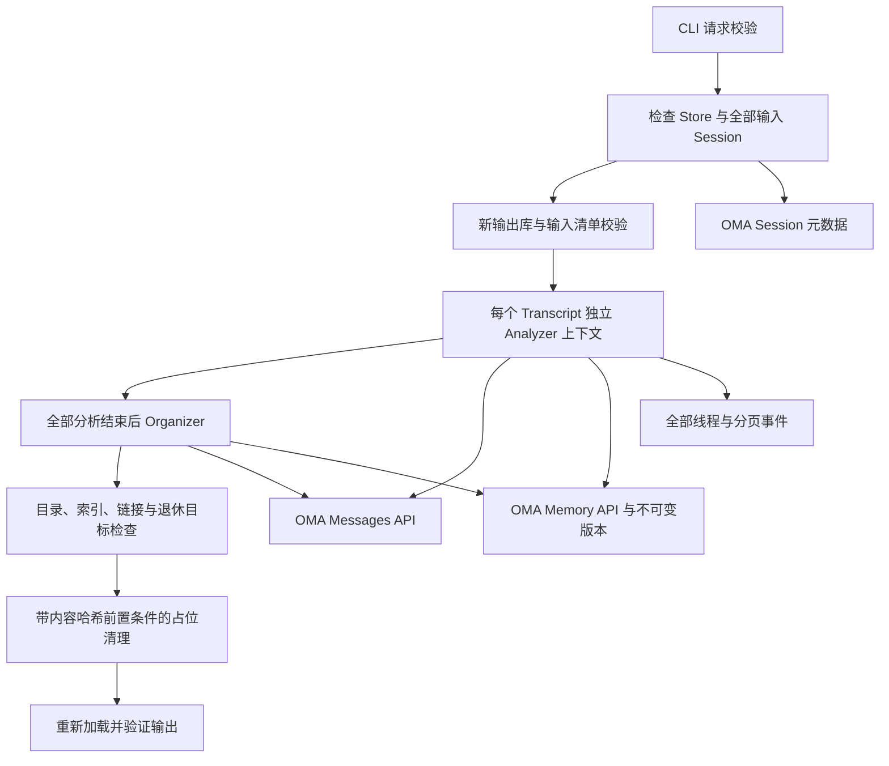

# Dreaming：可执行核心、来源与验收边界

更新时间：2026-11-11。OMA 基线：`37f58f3`；首批核心：`fb9ac1a`。

**当前交付仍是独立 `create_new` runner，不是完整的原生 `/v1/dreams` 服务。**
之前未推送的原生服务草稿无法从本分支检出，不计入已实现能力。这里只记录可从分支检出的代码和实际执行的验证。

## 来源边界

| 来源 | 对应实现 | 明确不作的推断 |
| --- | --- | --- |
| [官方 Create Reference](https://platform.claude.com/docs/en/api/http/beta/dreams/create) | 一个 Store、1–100 个唯一 Session、模型标准速度、instructions 边界、请求归一化 | 请求校验认识 `update_existing` 不代表执行器已支持 |
| [官方 Dreams guide](https://platform.claude.com/docs/en/managed-agents/dreams) | 输入失效、部分产出、失败和取消的资源状态 | 本地日志不冒充服务端 Session 事件流 |
| [官方 Analyzer](https://github.com/anthropics/claude-cookbooks/blob/ce8b2629efe8b24048b127b4c79af1e9cbab93d4/managed_agents/example_data/memory_distill/prompts/analyzer_system.md) | 完整读取、证据核验、保留不确定性、按主题组织、独立写后读回 | 串行实现不冒充官方示例的并行调度 |
| [官方 Organizer](https://github.com/anthropics/claude-cookbooks/blob/ce8b2629efe8b24048b127b4c79af1e9cbab93d4/managed_agents/example_data/memory_distill/prompts/organizer_system.md) | 合并后验证目标、退休占位、重定向链接、维护索引 | 文件结构正确不证明语义事实没有损失 |
| [官方清理工具](https://github.com/anthropics/claude-cookbooks/blob/ce8b2629efe8b24048b127b4c79af1e9cbab93d4/managed_agents/memory_distill_utils.py) | 模型无删除工具，宿主清理严格单行 `MOVED TO [[slug]]` 占位 | Cookbook 是公开示例，不是托管 Dreams 私有源码 |

没有引入 Letta、Mem0、MemOS 等第三方记忆框架。当前没有足以复现托管 Dreams 私有提示词或内部调用图的独立逆向证据，不能宣称“所有内部机制已逆向对齐”。提示词是依据上述公开来源独立撰写；CAS、预算、结构检查和失效检查频率属于本实现的工程选择。

## 执行与组件通信



`internal/dreams` 不依赖 HTTP 或数据库，定义受限执行器及能力接口；`internal/dreamclient` 映射 OMA 的 Memory、Session、Threads、Events 和 Messages HTTP 合同；`cmd/dream` 负责显式执行授权、信号取消及私有运行记录。

每次模型调用前、返回后和工具执行前检查输入可用性。HTTP 适配器只读元数据，不为检查重复导出 transcript；没有批量元数据接口时调用量与输入 Session 数成正比。原生实现将需要租户范围内的批量查询及与写入一致的校验，不能把这些 HTTP 检查说成原子撤权栅栏。

目录遍历使用已经取得的 Memory ID 直接读取正文，并验证路径和哈希；`grep`、复制和最终检查不会为每个文件再拉取整个目录。回归测试验证 40 个文件只需一次目录查询及 40 次正文读取。

## 核心不变量

- `create_new` 的输出必须与原 Store 不同，失败仍保留输出引用及已写入的部分内容。`update_existing` 在任何远端副作用前明确拒绝。
- 复制前记录路径、身份和内容哈希，复制后再次比较全部清单，检测新增、删除、改名及内容变化。它不是 PostgreSQL 事务快照，也不宣称输入在 Dream 创建时被冻结。
- Transcript 导出覆盖全部线程和分页，保留事件身份、工具错误及附件引用，不读取附件字节。独立 runner 要求导出期间 Session 稳定；后续持续检查输入是否仍可读取。
- 写已有文件前必须完整读过当前版本，并携带服务端 SHA-256 前置条件。Edit 要求唯一匹配。每次写入都产生新的验证义务，即使内容没有改变。
- 写后必须在后续模型轮次完整读回。同一回复里的 write/read 并列调用、旧的读覆盖记录和只读一部分都不能解除义务。模型未验证就结束时任务失败；不自动伪造模型检查。
- Analyzer 不能生成退休占位。Organizer 必须先完整读取并验证唯一、非空、非退休的目标，再替换旧页；不能退休索引、建立链或环。
- 宿主先检查整个输出，再清理严格单行退休占位；删除附带旧内容哈希，发生并发替换则失败并保留新内容。清理后重新读取检查整个输出。

## 输出结构检查的范围

非空输出需要 `/_index.md`。检查每个活动文件是否被索引，wiki 引用是否唯一且存在，索引里的本地 Markdown 目标是否存在，活动页面是否仍链接退休页，退休目标是否有效。代码围栏、行内代码及转义示例不作为 wiki 引用。

正文普通 Markdown 相对链接可能引用项目源码而非记忆，因此不会凭空把不存在于记忆库的项目路径视为缺失记忆。Wiki 链接则始终按记忆内部引用处理。支持简单 Markdown 及带尖括号的路径，不宣称实现完整 CommonMark 解析。

新提示词要求 frontmatter 和稳定 slug；有 frontmatter 时验证 name/description 与重复字段。旧的无 frontmatter 页面保持可读，不以格式迁移为由删除它们。结构检查不证明事实真实性、完整信息保留、提示注入免疫或下游任务收益。

清理目标读取和旧页删除是分开的 HTTP 请求，不是跨文件原子事务。独立 runner 的输出不应挂给其他 Agent 同时写。原生 `update_existing` 必须另行实现全写入口协调、租约栅栏和事务化恢复，不能直接复用这里的检查宣称分布式并发安全。

## 使用

```sh
go run ./cmd/dream -request docs/examples/dream-request.json
export OMA_API_KEY='workspace-key'
go run ./cmd/dream -request /private/request.json \
  -base-url http://localhost:38080 -allow-insecure-http \
  -records-dir /private/new-run -execute
```

未加 `-execute` 只校验。HTTPS 不加明文授权参数。目录必须新建，权限 0700；结果和日志为 0600。不得把 API key、真实 transcript 或运行记录推入仓库。日志记录操作元数据，不记录记忆正文。归档/记录不等于安全删除。

## 已执行验证

2026-11-11，在 Go 1.23.2 隔离模块中对本次实际源码运行：

```sh
go vet ./internal/dreams ./internal/dreamclient ./cmd/dream
go test -race -count=1 -cover ./internal/dreams ./internal/dreamclient ./cmd/dream
go test -race -count=10 ./internal/dreams ./internal/dreamclient ./cmd/dream
```

52 个顶层测试、含子测试 134 个通过，零失败、零跳过；十次重复竞态回归通过。覆盖率：core 85.0%，HTTP adapter 86.6%，CLI 46.5%。包含完整 Engine → HTTP fixture → 记忆读写、合并退休清理、并发占位替换保留的集成测试；模型为脚本模型，不是真实 Claude。

隔离模块只用于验证这三个无外部依赖的包，**没有修改仓库 go.mod，也没有替代原仓库的 Go 1.27、Yourbatis、PostgreSQL 和全量质量门禁**。官方 SDK、真实模型、原生 API、S3/NATS/SSE 全链路尚未验收。

当前 GitHub Actions 连不下载 Action、只执行版本检查的 runner-preflight 都在出现步骤记录前失败；后续测试作业被跳过。该记录不能算 CI 通过，失败原因也不能未经证据归因为项目代码或账单。

原生 API、持久化 River 作业、真实 pipeline Session、`update_existing` 与所有写入口协调、崩溃恢复、迟到计量、官方 SDK 和真实模型质量评测仍属于未交付范围；没有用不存在的草稿或文档宣称完成这些功能。
